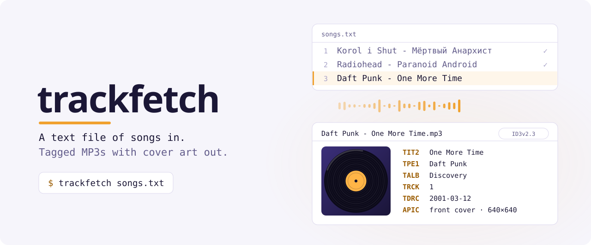

<p align="center">
  
</p>

<h1 align="center">trackfetch</h1>

<p align="center">
  <b>A text file of songs in, tagged MP3s with cover art out.</b>
</p>

<p align="center">
  <a href="https://pypi.org/project/trackfetch/"></a>
  <a href="https://pypi.org/project/trackfetch/"></a>
  <a href="https://github.com/trackfetch/trackfetch/releases/latest"></a>
  <a href="https://github.com/trackfetch/trackfetch/blob/master/LICENSE"></a>
</p>

<p align="center">
  <a href="#install">Install</a> ·
  <a href="#features">Features</a> ·
  <a href="https://github.com/trackfetch/trackfetch#readme">Documentation</a> ·
  <a href="https://github.com/trackfetch/trackfetch/releases/latest">Releases</a>
</p>

<p align="center">
  <picture>
    <source media="(prefers-color-scheme: dark)" srcset="https://raw.githubusercontent.com/trackfetch/.github/main/profile/assets/banner-dark.svg">
    
  </picture>
</p>

<p align="center">
  <b>English</b> · <a href="README.uk.md">Українська</a> · <a href="README.ru.md">Русский</a>
</p>

---

trackfetch reads a plain text file with one `Artist - Title` per line, finds
metadata, cover art and the best audio on YouTube or SoundCloud for each
song and saves the file with full tags. A run can be interrupted at any
point and resumed later, even with a thousand songs in the list.

## Features

| **Accurate matching**       | Of five YouTube results, official audio wins; covers, karaoke, nightcore, remixes and reactions lose                                           |
| --------------------------- | ---------------------------------------------------------------------------------------------------------------------------------------------- |
| **Metadata and album art**  | iTunes, Deezer, MusicBrainz, VocaDB and optional Spotify; art from the winning source, then Cover Art Archive, then YouTube thumbnails         |
| **Format of choice**        | MP3 for any player, or Opus and M4A without re-encoding                                                                                       |
| **Resume where you stopped** | Downloaded songs go to `done.txt`, failures with the reason to `failed.txt`                                                                   |
| **Any alphabet**            | Cyrillic and other non-Latin titles are matched correctly and kept                                                                             |
| **No Python required**      | Binaries for Linux, macOS and Windows on x86_64 and ARM64                                                                                     |

## Install

Homebrew and Nix also install yt-dlp, FFmpeg and Deno for you; with the
other ways you need them separately. The default iTunes source needs no API
key.

**pipx** (Python 3.10+)

```bash
pipx install trackfetch
```

**Homebrew** (macOS and Linux)

```bash
brew install trackfetch/tap/trackfetch
```

**Nix** (Linux and Apple Silicon Macs)

```bash
nix profile install github:trackfetch/trackfetch
```

Standalone binaries are on the
[releases page](https://github.com/trackfetch/trackfetch/releases/latest).

## Links

- [PyPI](https://pypi.org/project/trackfetch/)
- [Documentation](https://github.com/trackfetch/trackfetch#readme): configuration, metadata and music sources, troubleshooting
- [Homebrew tap](https://github.com/trackfetch/homebrew-tap)

## Contributing

Bug reports, matching improvements, docs fixes and translations are
welcome. How to report a wrong match and set up a development environment
is written in
[CONTRIBUTING.md](https://github.com/trackfetch/trackfetch/blob/master/CONTRIBUTING.md).
Security issues go through
[Security → Report a vulnerability](https://github.com/trackfetch/trackfetch/security/advisories/new),
not a public issue.

<p align="center">
  <sub>Licensed <a href="https://github.com/trackfetch/trackfetch/blob/master/LICENSE">GPL-3.0-or-later</a></sub>
</p>
