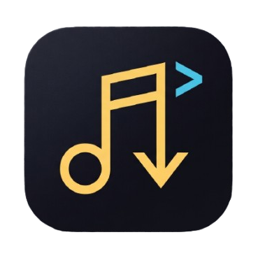
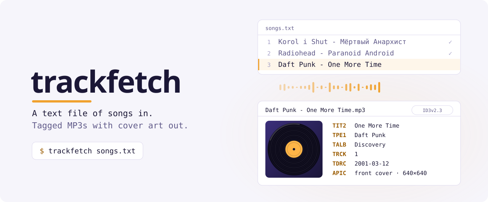

  

<h1 align="center">trackfetch</h1>

Текстовый файл с песнями на входе, MP3 с тегами и обложками на выходе.

  <picture>
    <source media="(prefers-color-scheme: dark)" srcset="assets/banner-dark.svg">
    
  </picture>

[English](README.md) | [Українська](README.uk.md) | Русский

trackfetch читает обычный текстовый файл, где на каждой строке записано
`Исполнитель - Название`. Для каждой песни он берёт метаданные и обложку из
настраиваемых бесплатных источников, выбирает самое подходящее аудио на
YouTube и сохраняет MP3 с полными ID3-тегами. Работу можно прервать в любой
момент и продолжить позже, даже если в списке тысяча песен.

- **Настраиваемые метаданные.** iTunes (по умолчанию), Deezer, MusicBrainz,
  VocaDB и необязательный Spotify.
- **Обложка альбома.** Берётся у победившего источника метаданных, затем из
  Cover Art Archive для MusicBrainz, затем из превью YouTube.
- **Правильная загрузка.** trackfetch оценивает пять результатов YouTube на
  каждую песню. Официальное аудио выигрывает, а каверы, караоке, nightcore,
  ускоренные, замедленные версии, ремиксы и реакции проигрывают.
- **Формат на выбор.** MP3 для любого плеера или Opus и M4A, которые
  сохраняют оригинальный звук YouTube без перекодирования.
- **Продолжение с места остановки.** Скачанные песни записываются в
  `done.txt` и при следующем запуске пропускаются. Ошибки попадают в
  `failed.txt` вместе с причиной.
- **Играет везде.** Теги записываются в формате ID3v2.3, который понимают
  Проводник Windows, Apple Music, Android, автомагнитолы и большинство
  плееров.
- **Любой алфавит.** Кириллица и другие нелатинские названия правильно
  сопоставляются и сохраняются в именах файлов.
- **Python не нужен.** Готовые бинарники для Linux, macOS и Windows на
  x86_64 и ARM64.

## Установка

Выбери любой способ. Homebrew и Nix сами ставят yt-dlp, FFmpeg и Deno; при
остальных способах их нужно поставить отдельно. Источнику iTunes по
умолчанию ключ API не нужен. Бесплатный ключ Spotify API необязателен и
нужен только если выбрать Spotify.

pipx (Python 3.10+):

    pipx install trackfetch

Homebrew (macOS и Linux):

    brew install trackfetch/tap/trackfetch

Nix (Linux и Mac на Apple Silicon):

    nix profile install github:trackfetch/trackfetch

Готовые бинарники для Linux, macOS и Windows (x86_64 и ARM64) — на странице
[релизов](https://github.com/trackfetch/trackfetch/releases/latest).

## Репозиторий

- Основной репозиторий: <https://github.com/trackfetch/trackfetch>
- PyPI: <https://pypi.org/project/trackfetch/>
- Документация: [README](https://github.com/trackfetch/trackfetch/blob/master/README.ru.md)
  описывает конфигурацию, источники метаданных и музыки, решение проблем и
  возможность продолжить прерванную загрузку
- Homebrew tap: <https://github.com/trackfetch/homebrew-tap>

## Контрибьюторы

Отчёты об ошибках, улучшения подбора, правки документации и переводы —
приветствуются. См.
[CONTRIBUTING.md](https://github.com/trackfetch/trackfetch/blob/master/CONTRIBUTING.md),
как сообщить о неправильном совпадении и настроить среду разработки.
Вопросы безопасности передавайте через
[Security → Report a vulnerability](https://github.com/trackfetch/trackfetch/security/advisories/new),
а не через публичный issue.

## Лицензия

[GPL-3.0-or-later](https://github.com/trackfetch/trackfetch/blob/master/LICENSE)
