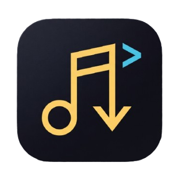
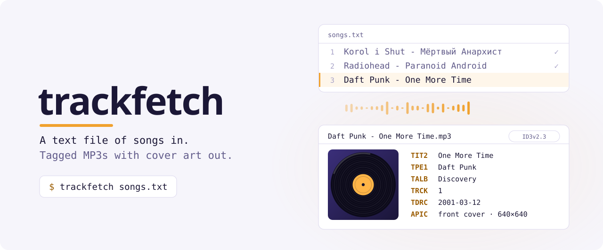

<p align="center">
  
</p>

<h1 align="center">trackfetch</h1>

<p align="center">
  <b>Текстовий файл із піснями на вході, MP3 з тегами та обкладинками на виході.</b>
</p>

<p align="center">
  <a href="https://pypi.org/project/trackfetch/"></a>
  <a href="https://pypi.org/project/trackfetch/"></a>
  <a href="https://github.com/trackfetch/trackfetch/releases/latest"></a>
  <a href="https://github.com/trackfetch/trackfetch/blob/master/LICENSE"></a>
</p>

<p align="center">
  <a href="#встановлення">Встановлення</a> ·
  <a href="#можливості">Можливості</a> ·
  <a href="https://github.com/trackfetch/trackfetch/blob/master/README.uk.md">Документація</a> ·
  <a href="https://github.com/trackfetch/trackfetch/releases/latest">Релізи</a>
</p>

<p align="center">
  <picture>
    <source media="(prefers-color-scheme: dark)" srcset="https://raw.githubusercontent.com/trackfetch/.github/main/profile/assets/banner-dark.svg">
    
  </picture>
</p>

<p align="center">
  <a href="README.md">English</a> · <b>Українська</b> · <a href="README.ru.md">Русский</a>
</p>

---

trackfetch читає звичайний текстовий файл, де в кожному рядку записано
`Виконавець - Назва`, підбирає для кожної пісні метадані, обкладинку та
найкраще аудіо на YouTube або SoundCloud і зберігає файл із повними тегами.
Роботу можна перервати будь-коли й продовжити пізніше, навіть якщо у списку
тисяча пісень.

## Можливості

| **Точний підбір**                 | З п'яти результатів YouTube перемагає офіційне аудіо, а кавери, караоке, nightcore, ремікси та реакції програвають                            |
| --------------------------------- | --------------------------------------------------------------------------------------------------------------------------------------------- |
| **Метадані та обкладинки**        | iTunes, Deezer, MusicBrainz, VocaDB і необов'язковий Spotify; обкладинка з джерела-переможця, потім Cover Art Archive, потім прев'ю YouTube   |
| **Формат на вибір**               | MP3 для будь-якого плеєра або Opus і M4A без перекодування                                                                                    |
| **Продовження з місця зупинки**   | Завантажені пісні записуються в `done.txt`, помилки з причиною в `failed.txt`                                                                 |
| **Будь-яка абетка**               | Кирилиця та інші нелатинські назви правильно зіставляються та зберігаються                                                                    |
| **Python не потрібен**            | Бінарники для Linux, macOS і Windows на x86_64 та ARM64                                                                                       |

## Встановлення

Homebrew і Nix самі ставлять yt-dlp, FFmpeg і Deno, при інших способах їх
треба поставити окремо. Джерелу iTunes типово ключ API не потрібен.

**pipx** (Python 3.10+)

```bash
pipx install trackfetch
```

**Homebrew** (macOS і Linux)

```bash
brew install trackfetch/tap/trackfetch
```

**Nix** (Linux і Mac на Apple Silicon)

```bash
nix profile install github:trackfetch/trackfetch
```

Готові бінарники лежать на сторінці
[релізів](https://github.com/trackfetch/trackfetch/releases/latest).

## Посилання

- [PyPI](https://pypi.org/project/trackfetch/)
- [Документація](https://github.com/trackfetch/trackfetch/blob/master/README.uk.md): конфігурація, джерела метаданих і музики, розв'язання проблем
- [Homebrew tap](https://github.com/trackfetch/homebrew-tap)

## Участь у проєкті

Звіти про помилки, покращення підбору, правки документації та переклади
вітаються. Як повідомити про неправильний збіг і налаштувати середовище
розробки, написано в
[CONTRIBUTING.md](https://github.com/trackfetch/trackfetch/blob/master/CONTRIBUTING.md).
Питання безпеки передавайте через
[Security → Report a vulnerability](https://github.com/trackfetch/trackfetch/security/advisories/new),
а не через публічний issue.

<p align="center">
  <sub>Ліцензія <a href="https://github.com/trackfetch/trackfetch/blob/master/LICENSE">GPL-3.0-or-later</a></sub>
</p>
